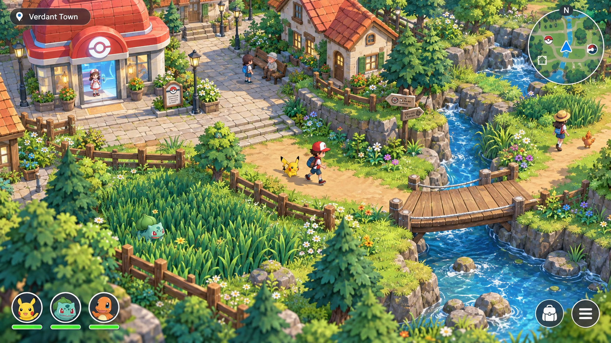

# Isometric Pokémon Game

Planning workspace for a single-player, stylized 3D Pokémon adventure in Unreal Engine.

**Status: first town-corner build delivered.** The native Unreal project, reusable environment kit and small gardener errand are implemented, packaged and checked through the complete rendered errand with a verified save. Evidence and limits are tracked in [the delivery report](docs/town-corner-delivery.md). The larger catalog/battle/story systems remain planned. The concept image below is a visual reference, not an engine screenshot.

Start the compiled game with `Play Town.cmd`, or open `Game/VerdantTrails.uproject` in Unreal 5.8. Build instructions and controls are in [the delivery report](docs/town-corner-delivery.md); reusable source assets and conventions are in [the kit guide](assets/town-kit/README.md).

Start with the [documentation index](docs/README.md), then review the [decisions](docs/decisions.md) and [game design](docs/game-design.md).

The accepted [story and end-game](docs/story-and-endgame.md) follows a habitat-displacement mystery, a Championship rivalry, and postgame restoration and battle challenges. The first playable is Chapter 1, **The Silent Stream**.

Pokémon reference data will come from [PokéAPI v2](https://pokeapi.co/api/v2/). The game will use a validated local snapshot so ordinary play does not require API access. Project maps, encounters, battle execution, saves, and 3D assets have separate ownership.

Created: 2026-10-15, Asia/Manila.
