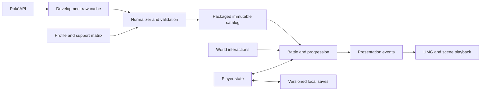

# Technical architecture

Status: proposed full-game architecture. The separate town-corner foundation is implemented and packaged with Unreal 5.8.3 and the verified toolchain in [the delivery report](town-corner-delivery.md); catalog and battle systems below remain proposed.

## Unreal foundation

Use the installed compatible Unreal Engine version after verification. Do not assume the version displayed by online documentation is the installed version. Start a small desktop project with a custom character/controller and orthographic camera; no dependency on an online service for the first playable.

Proposed C++ owns deterministic battle rules, normalized catalog access, individual Pokémon state, inventory transactions, and persistence. Blueprints own world assembly, NPC interactions, animation, camera presentation, and UMG screens. Rules must remain callable without a rendered world so meaningful simulation tests are possible.

Unreal's [data-driven gameplay facilities](https://dev.epicgames.com/documentation/en-us/unreal-engine/data-driven-gameplay-elements-in-unreal-engine) and [SaveGame framework](https://dev.epicgames.com/documentation/en-us/unreal-engine/saving-and-loading-your-game-in-unreal-engine) are implementation candidates. Their presence does not automatically supply validation, migrations, transaction safety, or backup recovery; those are project requirements.

## System boundaries

| System | Owns | Must not own |
| --- | --- | --- |
| Catalog service | Immutable definitions, provenance/profile checks, ID resolution | Player HP, caught individuals, network refresh during battle |
| Player state | Trainer identity, party/storage, inventory, currency, Pokédex, progress | Mutable copies of canonical species facts |
| World interaction | Collision, prompts, NPCs, transitions, encounter eligibility | Battle damage or persistence serialization |
| Encounter director | Local area tables, roll cadence, spawn requests, RNG stream | Invented species facts or HTTP calls |
| Battle simulation | Valid commands, turn state, RNG, effects, event log, results | Widgets, camera timelines, animation callbacks deciding results |
| Battle presentation | Arena, HUD, animation, sound, event playback | Awarding items/experience directly |
| Progression coordinator | Level-up prompts, move replacement, evolution, completion order | Changing catalog records |
| Save service | Versioned snapshots, safe writes, migration/recovery | Running UI animation or fetching missing catalog facts |
| UI/input coordinator | Focus, action mapping, modal ownership, accessible feedback | Applying gameplay transactions independently |

Proposed persistent services live at game-instance lifetime; map-scoped actors own spatial interactions. Bind/unbind events across map changes to avoid duplicate grants and stale widget references.



## Proposed project layout

The following full-game subdirectories remain proposed. The delivered corner currently uses the flatter `Game/Source/VerdantTrails/` module with `TownKit`, `VerdantGame`, `TownRules` and `TownSave`:

```text
Game/                         Unreal project root after version confirmation
  Source/<GameModule>/
    Catalog/                  Typed definitions and ID resolution
    Battle/                   Simulation, commands, effects, fixtures
    Player/                   Party, storage, inventory, progression
    Persistence/              Save contracts and migration
    World/                    Interactions and encounter integration
  Content/
    Data/                     Generated catalog assets; no manual fact edits
    Characters/               Trainer and Pokémon presentation bindings
    Environments/             Town, route, interiors, clearing
    UI/                       Widgets, styles, input hints
    Audio/                    Validated local audio assets
    Maps/                     World and battle maps
tools/pokeapi/                Future importer and validators
data/pokeapi/                 Future accepted snapshots and manifests
docs/                        This planning pack
```

Before first code exploration, use the required global Graphify workflow. Current folder contains documentation and research data only, so no code graph was created. Once code exists, create/query a local code-only graph before source exploration and update it after changes. Exclude Unreal `Binaries`, `DerivedDataCache`, `Intermediate`, `Saved`, generated assets, raw research/media, and graph outputs from code indexing as appropriate. Never force through a graph shrink warning silently.

## Individual Pokémon contract

A persistent individual needs: instance UUID, species ID, Pokémon/variety ID, nickname, ownership, level, cumulative experience, nature ID, ability ID/slot, IVs, EVs if enabled by profile, learned move IDs and current PP, current HP, persistent conditions, acquisition metadata, and presentation-independent flags.

Calculated stats derive from the pinned definitions/profile plus individual inputs. Cache only with a version tag and invalidate on level, form, nature, or profile changes. Validate level/experience consistency and HP/PP bounds during load. UUIDs distinguish two Pokémon of the same species. Party and storage reference individuals without duplicating ownership.

## Battle state and transactions

Proposed state sequence:

```text
Prepare -> Intro -> AwaitCommands -> ResolveTurn -> PlayEvents
                       ^                               |
                       |        Replacement <----------+
                       +-------------------------------+
                                      |
                               Outcome -> Rewards
                                      -> ProgressionPrompts -> ReturnToWorld
```

Implement an explicit transition table with terminal outcomes: victory, defeat, capture, and successful flee. Invalid commands return a reason without changing inventory, PP, or turn state. Validate legal targets again when resolving an action; a fainted target cannot receive an ordinary attack. Forced replacement is not another free ordinary turn.

Use a seeded RNG with stored state and separate streams for world encounters and battles. Record the profile, starting state, committed commands, and simulation events for reproducible fixtures. Presentation can skip or speed up events without replaying mutations.

Each battle and one-time world grant receives a stable transaction ID. Apply capture, item use, currency, rewards, Pokédex flags, and party changes to one coherent working state. Record completion so return-to-world callbacks cannot award twice. Disable duplicate input while committing.

Proposed crash policy: persist a pre-battle checkpoint; do not save partial turns. During battle, changes exist in working memory. Persist the completed result before returning control. A crash before successful result persistence resumes the pre-battle checkpoint, rolling back both consumption and gains. A failed result write remains pending with retry feedback; never claim success or overwrite the checkpoint with incomplete state. This policy trades exact mid-battle resume for a coherent first implementation.

## Saves and recovery

Header: save schema version, build ID, catalog ID, rules profile ID, playthrough UUID, timestamp, and integrity metadata. Payload: individual registry, party/storage references, inventory/currency, Pokédex, quest/NPC/pickup flags, healing location, safe world position, play time, settings linkage, committed transaction identifiers.

Write into a candidate slot, validate it by reading back, and only then promote it through a tested platform-safe replacement mechanism. Keep the last valid backup and never destroy it on failed migration or disk-full errors. The precise storage adapter must be proven against the selected Unreal version; do not assume asynchronous SaveGame means atomic storage.

Serialize concurrent save requests. Show pending/success/failure distinctly. Autosave at safe boundaries after starter choice, map transition, healing, and completed committed progression. Manual saving is disabled during unresolved battle/progression transactions with an explanation.

Load into temporary state, validate all references and bounds, migrate supported versions, then replace active state. Corrupt saves offer a backup restore; unknown newer schemas or incompatible catalogs explain the problem and retain files. Continue never silently starts a new game.

## Failure requirements

| Failure | Required behavior |
| --- | --- |
| API unavailable during import | Use explicit cached mode or fail candidate creation; preserve accepted catalog |
| Missing required catalog ID/handler | Validation/package failure with resource identity; no silent default Pokémon |
| Missing optional icon/cry | Identified placeholder/silence; log asset issue |
| Missing mesh in final roster | Fail content readiness; graybox remains marked provisional |
| Save write failure | Preserve last valid save, report failure, allow retry |
| Duplicate input/callback | Idempotent command/transaction; no duplicate rewards or capture |
| Map transition failure | Preserve player state and checkpoint; recover to safe map |
| Gamepad disconnect/modal change | Restore usable focus and input ownership |

## Validation approach

Use importer/schema checks and deterministic simulation fixtures first. Meaningful tests cover null fields, graph references, version filters, effect behavior, capture capacity, transaction replay, and save corruption/recovery. Unreal build/cook tests establish compilation and packaging only. In-engine visual/input, physical controller, performance, and packaged offline play each need separate evidence. No such game tests have run yet.
