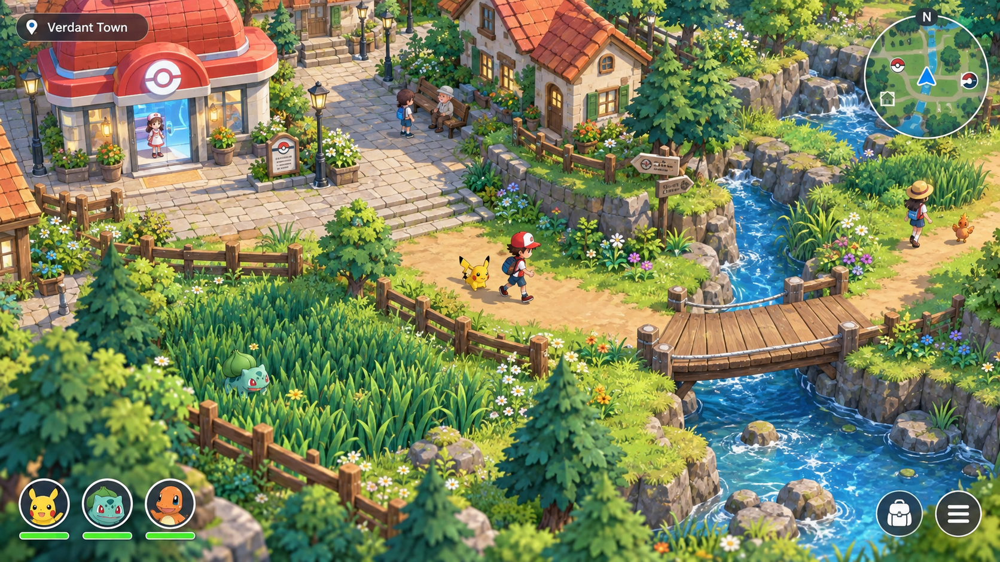

# Visual direction

Status: on 2026-10-16 the user required the supplied image's same look and design, with a "100%" match goal. The first town corner has been implemented and rendered, but has not met this visual target. See [the delivery report](town-corner-delivery.md) for observed frames and remaining limits, and [the asset brief](game-brief-for-assets.md#required-reference-scene) for the required scene breakdown and visual approval gate.

The image is the mandatory production target, rather than a loose inspiration. Reproduce its composition, architecture, density, materials, characters, water, lighting and HUD. Its generated pixels do not provide ready-made game assets or prove achievable performance. Literal pixel identity across a moving 3D game is not guaranteed; establish acceptance through aligned actual-engine captures and user review. Do not claim the current preview is a completed match.

## Camera and framing

Proposed starting camera: orthographic projection, yaw 45 degrees, pitch approximately -35.264 degrees, fixed rotation, smooth follow. Test the framing in the installed Unreal version before locking values. Unreal supports an orthographic camera; see [Epic's documentation](https://dev.epicgames.com/documentation/en-us/unreal-engine/orthographic-camera-in-unreal-engine).

Choose orthographic width after blocking out the trainer, houses, paths, and bridge at consistent scale. The player should recognize movement options without the trainer becoming a tiny map marker. Use discrete bounded zoom only if it preserves that readability. Motion smoothing and transitions should be reducible in settings.

The game fills the window. No decorative outer canvas, floating diorama base, browser frame, or promotional title treatment. Adapt framing and HUD safe areas for 16:9, 16:10, and ultrawide; never stretch the world or crop essential commands.

Fade or hide obstructing roofs/trees with stable occlusion rules. Retain collision and restore their appearance after the player leaves. Avoid flicker near occlusion thresholds and don't reveal entire interiors through unrelated buildings.

## Environment

Warm roof tiles, cream plaster, rounded stone, timber fences, layered green foliage, flowers, and clear blue water. Broad shapes establish navigation; small decorative detail should not compete with interaction prompts or characters.

Tall grass must be distinct from non-encounter foliage through silhouette and movement. Bridges and exits need obvious walking surfaces. Maintain consistent meters-to-centimeters scale and collision separate from decorative geometry.

Start with one shared material family, controlled roughness, soft daylight, ambient contact shadows, and restrained water effects. Advanced rendering features are optional until profiled on target hardware. Avoid heavy blur, exaggerated bloom, and effects that obscure paths.

## Trainer and Pokémon

Readable stylized proportions with consistent art direction. Minimum trainer animation set: idle, walk, run, interaction, and battle command gesture. Minimum Pokémon set: idle, locomotion, attack cue, hit, faint, and capture/release presentation where applicable. Animation variations may share systems but must preserve each creature's recognizable silhouette.

Species dimensions are reference data, not an automatic world-scale multiplier. Record any presentation scaling in the local asset manifest so tiny and very large creatures remain readable without changing gameplay facts.

PokéAPI sprite/artwork and cry references can support menus, placeholders, or reference sheets. They do not provide a ready-to-use animated 3D character pipeline. Obtain models, rigs, animations, environment assets, effects, and music separately, recording source and usage status per asset. A generic graybox placeholder must be identified as a placeholder, not represented as a finished Pokémon model.

## HUD

- Top left: compact location name; temporary objective cue when needed.
- Top right: reference-matching circular minimap with white border, north indicator, illustrated terrain, player arrow and landmark icons.
- Bottom left: reference-matching circular portraits and green bars; use the pictured three-portrait state for the matching view and provide an obvious expanded view for all six party members in normal play.
- Bottom right: reference-matching circular bag/menu shortcuts with matching input hints.
- Battle: readable HP, level, status, move type, PP, and legal command state.

Use translucent panels sparingly; preserve contrast against bright grass and water. Type/status information needs text or icons as well as color. Include clear full-party, no-PP, fainted, disabled-action, save-failed, and unknown-entry states. Avoid unnecessary implementation terms in player-facing messages.

## Visual acceptance

First capture a repeatable actual-engine 16:9 view matching the supplied reference; compare side by side, with an aligned overlay and with close crops. Follow the asset brief's visual approval gate and record unresolved differences. The required matching view includes the healing building, cottage/plaza, tall grass, rocky stream/cascades, timber bridge, dense dressing, reference character appearances and HUD. These details remain required even where the earlier prototype omitted them.

Then capture town, grass, bridge, healing interior and battle as those areas become available. Check player visibility, roof occlusion, foliage edges, UI legibility, keyboard/controller focus, aspect ratios and reduced-motion behavior. Concept art alone cannot satisfy these checks. The user previously authorized rendered Unreal/gameplay checks for the corner; completed evidence is in the delivery report. This documentation update does not itself run new tests or establish visual acceptance.
